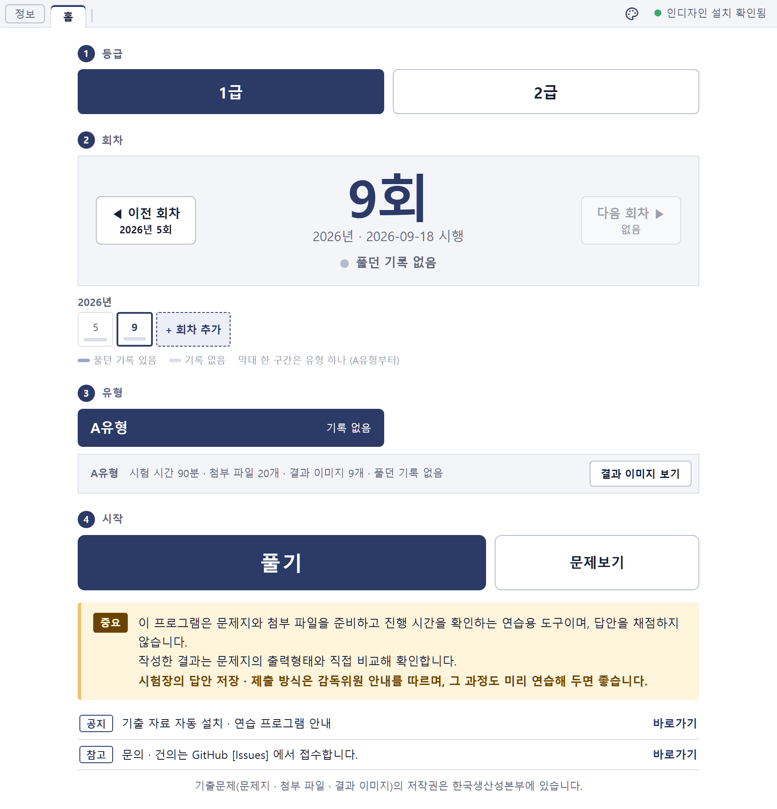

# 고잉 기출풀기 GTQid

GTQid(그래픽기술자격 인디자인) 실기 기출문제와 응시 종목 프로그램을 실행해 바로 연습할 수 있게 하는 프로그램입니다.

문제지와 첨부 파일 · 결과 이미지를 준비하고, 인디자인을 실행해 문제지 옆에 배치하며, 진행 시간을 표시합니다.

## 하는 일

- 등급 · 회차 · 유형을 선택하고 [풀기] 를 클릭하면 문제지를 표시하고, 인디자인을 실행해 문제지와 나란히 배치합니다.
- 첨부 파일은 문서\GTQ\Image, 결과 이미지는 문서\GTQ\Output 폴더에 문제지에 표시된 대로 복사합니다.
- 문제지 화면에서 [결과 이미지] 를 클릭하면 결과 이미지를 바로 확인합니다.
- 화면 아래쪽에 시험 시간(90분) 남은 시간이 표시됩니다.
- [문제보기] 로 문제지만 바로 확인합니다.
- 회차 자료는 회차를 처음 열 때 다운로드합니다.
- 목록에 없는 회차는 주관처 공식 사이트 기출문제 게시판에서 다운로드한 압축 파일을 [회차 추가] 에 끌어다 놓아 추가합니다.

## 채점하지 않습니다

이 프로그램은 문제지와 첨부 파일을 준비하고 진행 시간을 확인하는 연습용 도구이며, 답안을 채점하지 않습니다.

작성한 결과는 문제지의 출력형태와 직접 비교해 확인합니다.

## 필요한 것

- 윈도우 10 (32비트 · 64비트) · 윈도우 11

## 설치

1. [최신 설치 파일 다운로드](https://github.com/program-going/gichulpulgi-gtqid/releases/latest) 에서 `.exe` 파일을 다운로드합니다.
2. 다운로드한 파일을 실행하고 설치 화면의 안내대로 진행합니다.
   - 처음 실행할 때 '윈도우의 PC 보호' 창이 나오면 [추가 정보] → [실행] 을 클릭합니다.
3. 바탕 화면의 [고잉 기출풀기 GTQid] 를 실행합니다.

지난 버전은 [Releases](https://github.com/program-going/gichulpulgi-gtqid/releases) 에 있습니다.

## 업데이트

새 버전이 있으면 프로그램을 실행할 때 안내 창이 표시됩니다.

[업데이트] 를 클릭하면 새 버전을 설치하고 프로그램이 다시 실행됩니다.

안내 창을 닫은 뒤에는 [정보] → [업데이트 확인] 으로 새 버전을 직접 확인할 수 있습니다.

## 실제 시험과 같게 연습하기

문제지는 문서\GTQ\Image 폴더의 첨부 파일로 작성하고, 답안을 문서\GTQ 폴더에 "수험번호-성명-문제번호.indd" (문제에 따라 pdf · epub 도) 로 저장하라고 합니다.

이 프로그램도 같은 폴더에 첨부 파일을 복사하고, 같은 폴더를 답안 폴더로 씁니다.

[풀기] 를 클릭할 때마다 첨부 파일을 그 회차 · 유형의 파일로 변경합니다.

시험장의 답안 저장 · 제출 방식은 감독위원 안내를 따릅니다.

## 문의

사용 중 궁금한 점이나 오류는 [Issues](https://github.com/program-going/gichulpulgi-gtqid/issues) 에 글로 남겨 주세요.

사용 후기는 [Discussions](https://github.com/program-going/gichulpulgi-gtqid/discussions) 에 남겨 주세요.

글을 남기려면 GitHub 로그인이 필요합니다.

## 저작권

- 기출문제(문제지 · 첨부 파일 · 결과 이미지)의 저작권은 한국생산성본부에 있습니다.
- 프로그램: © 2026 GoingLabs. All rights reserved.
